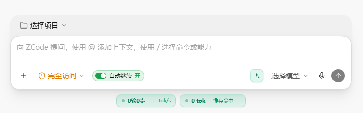
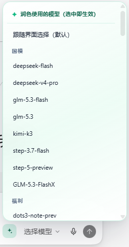
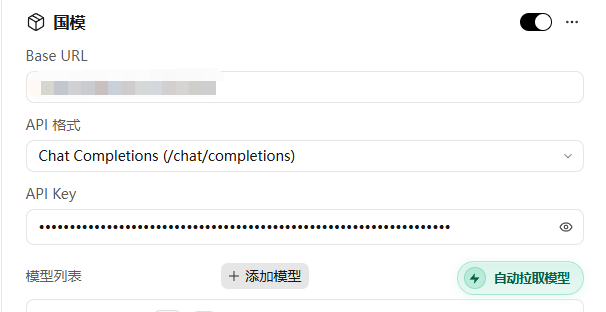
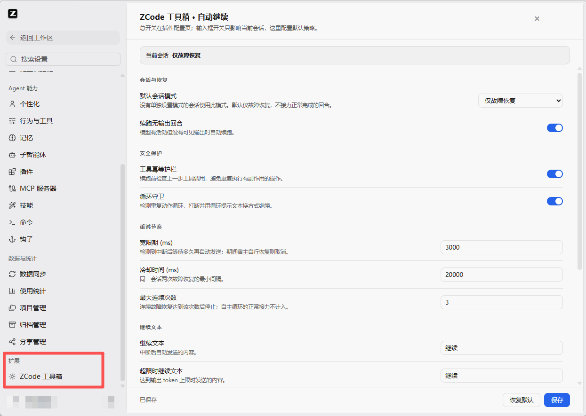
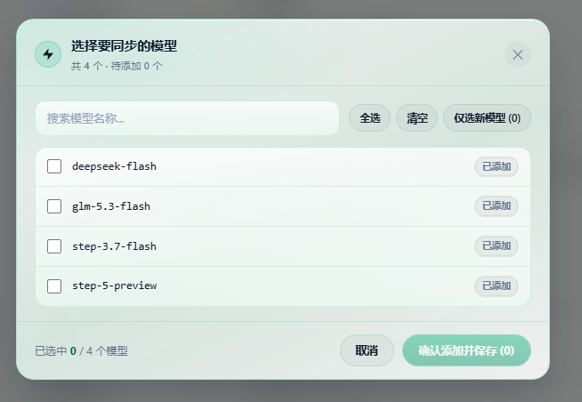

# zcode-pilot · ZCode 客户端一站式原生增强套件

<p align="left">
  <a href="https://github.com/HUIdada1/Zcode-Tools/releases"></a>
  
  
  
  <a href="LICENSE"></a>
</p>

为 ZCode 桌面客户端补齐极致原生体验与生产力增强：
- 🔁 **自动继续与循环守卫**：一轮意外中断、超限、无输出或只输出推理时自动补发续跑文本；检测到重复动作循环会打断并换方式继续。开关就放在输入框「模式切换」右侧，**只影响当前会话**；设置页另有独立的「ZCode Pilot」侧边 tab 可自定义策略。
- 📊 **实时 TPS 遥测状态栏**：输入框下方左右双框统一绿色主题——左框轮/步/生成速度，右框总 Token/缓存命中；点击展开毛玻璃明细（会话统计 / Token 用量），无操作 15s 自动收起。
- ✨ **提示词智能增强**：输入框旁一键重写润色草稿；**右键自由选择**润色所用模型，毛玻璃菜单、支持一键恢复；鼠标悬浮不再弹原生提示。
- 📈 **用量图表全量展开**：破除官方 Top 5/6 截断限制，全量展示所有模型的调用趋势与占比。
- ⚡ **一键模型同步**：设置页一键获取供应商 `/models` 模型列表，勾选即刻自动建条目并写入；按钮与选择弹窗统一毛玻璃质感。
- 🛡️ **无感自愈看护**：自动感知客户端与插件升级，后台单例看护静默守护，**彻底解决“客户端一升级补丁就失效”！**

> **纯 Python 标准库驱动**：零第三方依赖、免编译；改动仅作用于**本地客户端文件**；  
> 全量操作严格幂等，支持状态核查与逐项/全量精确还原。
>
> ⚠️ **声明**：非官方开源套件，与 ZCode 官方团队无关联。第三方声明见 [NOTICE.md](NOTICE.md)。  
> （GitHub 仓库为 `HUIdada1/Zcode-Tools`，**插件市场 id 为 `zcode-pilot`** —— 与早期的 `zcode-tokenspeed` 不再是同一个插件、也不再共用同一个市场；配置键随之为 `zcode-pilot@zcode-pilot`）。

---

## ⚡ 三分钟极速上手（推荐，全程零命令）

适合所有使用 ZCode 桌面端的用户，安装过程**完全无需打开命令行**：

| 步骤 | 操作说明 |
|:---:|---|
| **1. 环境确认** | 确认电脑已安装 **Python 3.10+**（系统自带或环境变量已配置）及 **ZCode 客户端**（实测支持 3.11.2 ~ 3.18.2，当前验证 3.18.2） |
| **2. 添加市场** | 打开 ZCode **设置 → 插件 → 右上角「创建」→「添加插件市场」**，来源填：<br>`HUIdada1/Zcode-Tools` |
| **3. 安装插件** | 在「个人」分段找到 **ZCode 原生体验增强**（`ZCode Pilot`），点 **安装**（装好默认启用） |
| **4. 自动激活** | **完全退出并重启 ZCode**（托盘右键退出），在新会话中发任意一条消息，后台看护进程将自动完成注入并在下次启动后展现全部增强功能！ |

> 💡 **全自动开箱即用**：插件清单内所有功能默认全开，无需打开配置页。如需关闭某项，在插件配置页拨成关并保存即可。

> 🔄 **一键更新（0.8.1 起自动重注入）**：市场会按插件清单里的 `version` 做版本检测。已装旧版的用户在 **设置 → 插件** 刷新市场后，插件卡片会出现「有更新」徽标，点单插件更新或顶部「全部更新」即可。更新只替换插件目录；后台常驻看护会在你**完全退出 ZCode 一次**（托盘右键 → 退出）的瞬间发现版本变化，直接改用**新版插件目录**的脚本重写 `app.asar`，写完自动把客户端重新拉起来 —— **不需要手动运行任何命令，也不用退第二次**。

> 🧬 **客户端自己升级了，也会自动再注入**：ZCode 升级会整体覆盖 `app.asar`，注入的界面随即消失；插件在**下一次会话启动**时用客户端指纹（版本号 + asar 大小）识别出这次升级，自动把全部补丁重新排给后台看护，你只需要**完全退出一次**（托盘右键 → 退出），看护在退出瞬间写入并自动拉起客户端。三条边界要清楚：
> 1. **必须先有一次会话启动** —— `SessionStart` 是官方规范里最早的自动触发点（插件清单没有「安装时钩子」）；
> 2. **退出后不要手动抢跑** —— 写入约 10–60 秒，期间手动打开 ZCode 会让写入被拒绝，只能再退一次；
> 3. **新客户端若改了 asar 结构**，脚本会按设计「拒绝盲改」并在会话里明确提示，这时才需要更新插件（0.9.0 / 0.9.1 / 0.9.2 已分别复核 3.18.0 / 3.18.1 / 3.18.2 契约）。

---

## 🧩 核心功能矩阵

| 特性 | 功能名称 | 核心效果 | 改动范围 |
|:---:|:---|:---|:---|
| 🛡️ | **升级自动自愈** | 客户端升级、**插件市场更新**都会自动感知：完全退出一次即由常驻看护用新版脚本重注入并自动重启，无需手动命令、无需退第二次 | 状态监控器 |
| 🔁 | **自动继续** | 输入框「模式切换」右侧常驻开关（按会话独立，只影响当前对话）；中断 / 超限 / 无输出 / 仅推理时自动补发续跑文本，默认宽限 3s、冷却 20s、最多连发 3 次；provider 流中断等 TurnError 由渲染层兜底续跑；设置页「ZCode Pilot」tab 可自定义 | `app.asar` 注入脚本 + IPC |
| 🌀 | **循环守卫** | 独立运行：识别重复动作循环后打断当前轮，并用「换方式继续」重启运行；当前会话关闭自动继续时同步失效 | `app.asar` 注入脚本 |
| 🗂️ | **中断会话恢复** | 客户端意外退出时记录在途轮次，下次启动可一键恢复该会话 | `app.asar` 注入脚本 + IPC |
| 📊 | **实时 TPS 遥测栏** | 输入框下方固定左右双框（统一绿色）：左框 `N轮M步 · Xtok/s`，右框 `总 Token · 缓存命中`；点击展开毛玻璃明细，无操作 15s 自动收起 | `app.asar` 注入脚本 |
| ✨ | **提示词增强润色** | 输入框旁「增强提示词」按钮（悬浮无原生提示），右键毛玻璃菜单按供应商自选润色模型，持久化且免重启 | `app.asar` 注入脚本 + IPC |
| 📈 | **用量图表去截断** | 「设置 → 用量」趋势图与饼图不再被 Top 5 / Top 6 截断，全量展示所有模型 | `app.asar` 渲染层 |
| ⚡ | **设置页模型拉取** | 设置页「自动拉取模型」玻璃胶囊按钮；选择弹窗为毛玻璃面板，自动从供应商同步可用模型并批量写入 | `app.asar` 注入脚本 + IPC |
| 🧠 | **思考档位原生配置** | 为各模型配置 `provider_config.json` 档位（3.14+ 原生 optionSpecs，无需内核改动） | 用户配置 JSON |
| ⚙️ | **思考内核补丁（旧版）** | ≤3.11 旧版内核专用兜底方案（3.14+ 自动识别并跳过，安全无侵入） | `zcode.cjs` |

---

## 📸 界面实拍

> 以下为本机浅色主题实拍；深色主题下同一套界面同样是绿色玻璃质感。

<p align="center">
  <br>
  <sub><b>输入框</b>：「模式切换」右侧是自动继续开关（按会话独立）；下方左右双框实时显示轮/步/速度与总 Token/缓存命中</sub>
</p>

<p align="center">
  <br>
  <sub><b>提示词增强</b>：在输入框旁的按钮上<b>右键</b>，按供应商分组选择润色模型，选中即生效、免重启</sub>
</p>

<p align="center">
  <br>
  <sub><b>一键模型同步</b>：设置 → 供应商 → 模型列表旁的「⚡ 自动拉取模型」</sub>
</p>

<p align="center">
  <br>
  <sub><b>设置 → 扩展 → 「ZCode 工具箱」</b>：默认模式、宽限期、冷却、最大连发次数与各类继续文本都在这里</sub>
</p>

<p align="center">
  <br>
  <sub><b>模型勾选弹窗</b>：搜索、全选 / 清空 / 仅选新模型，确认后一次性写入供应商配置</sub>
</p>

---

## 🛠️ 故障排查与一键自愈

> 💡 **0.6.11 自愈机制**：客户端升级会覆盖官方原版文件导致补丁失效。本插件在检测到升级后会自动重新排期看护，**通常只需在会话中收到提示后，完全退出并重启一次 ZCode 即可自动恢复！**

若遇到特殊情况（如杀毒软件拦截、网络断开等）导致功能未生效，请按以下方式排查与一键修复：

### 方案 A：客户端内一键修复（推荐，无需打开终端）
在 ZCode 任意对话窗口直接输入内置斜杠命令，AI 助手将自动帮您检测或打补丁：
- 输入 `/zcode-patch-doctor`：一键诊断健康状态与卡点；
- 输入 `/zcode-patch-apply`：一键自动重新应用所有增强补丁。

### 方案 B：全电脑通用单行自愈命令（适配所有电脑，任何路径直接粘贴）
无论您是否克隆过本仓库，也不管您在哪个路径打开终端，**直接复制并运行以下命令**（脚本会自动在系统插件缓存中搜寻并执行自愈，纠正启用状态并自动补齐所有补丁）：

```powershell
# Windows (CMD 或 PowerShell 任意路径直接运行)
python -c "import pathlib,subprocess,sys; h=pathlib.Path.home(); p=next(iter([*h.glob('.zcode/**/zcp_doctor.py'),*h.glob('.zcode/**/doctor.py')]),None); subprocess.run([sys.executable,str(p),'--fix']) if p else print('未找到已安装的 ZCode 插件，请先在客户端内安装')"
```

```bash
# macOS / Linux (任意终端直接运行)
python3 -c "import pathlib,subprocess,sys; h=pathlib.Path.home(); p=next(iter([*h.glob('.zcode/**/zcp_doctor.py'),*h.glob('.zcode/**/doctor.py')]),None); subprocess.run([sys.executable,str(p),'--fix']) if p else print('未找到已安装的 ZCode 插件，请先在客户端内安装')"
```

### 方案 C：换台电脑 / 更新插件后「完全退出也没注入」专查（0.9.3）

先弄清楚注入链路的时序 —— 看护是**在会话启动那一刻**挂上的：

```
开新会话（发条消息） → 钩子跑同步 → 挂起「退出后看护」
→ 完全退出 ZCode（托盘右键 → 退出） → 看护写入补丁 → 自动拉起 ZCode
```

所以**市场「更新」只换插件目录，那次退出的值岗的还是旧看护**（0.9.2 之前它会被
客户端退出连坐杀掉）。正确姿势：**更新后先开个新会话发条消息，再完全退出**，
让新版插件的看护上岗。

0.9.3 起看护启动带「点火 → 活性确认 → 兜底」三段链路与心跳单例，历史上两类
「退了也不注入」的哑故障已修复：① 计划任务点了火但 pythonw 被杀软拦掉（无人值岗）；
② 旧看护的 PID 残留被 Windows 复用给无关进程，导致新看护永远不再启动。
若仍不生效，按 方案 B 跑 `--fix`，输出里重点看两行：
- **「最近一次看护拉起方式」**：`计划任务·树外` 正常；`Popen·树内` = PowerShell 与
  schtasks 都被策略拦截（树内看护会被退出连坐收走），需放开限制；
- **「看护正在运行（PID …，心跳确认）」**：看到这行后再退出才会写入；没有就先跑 `--fix`。

---

## 🎯 常用特性使用技巧

### 1. 增强提示词（右键自由指定模型）
- **左键点击**：根据当前选定模型一键润色重写草稿，支持一键「恢复原文」；
- **右键点击**：弹出供应商模型列表，可自由指定轻量、快速或专用模型（如 Claude 3.5 Haiku、GPT-4o-mini）专门用于润色，选择后**持久化保存且立即生效**。

### 2. 自动继续与循环守卫
- **开关位置**：紧贴输入框「模式切换」按钮右侧，一眼可见、一点即切；开关上的三态（开 / 暂停 / 循环 / 关）就是唯一状态显示，不再往会话区插提示框；
- **只影响当前会话**：每个对话框独立记录自己的模式（跟随默认 / 关闭），切换对话不会串状态；默认策略为「仅故障恢复」，不接力正常完成的回合；
- **什么时候会自动继续**：一轮意外中断、命中输出 token 上限、整轮没有任何输出、只输出了内部推理就结束；默认宽限 3s、冷却 20s、最多连发 3 次；
- **失败轮次兜底（TurnError）**：provider 流中断（如 `upstream_stream_read_error`）、SSE 解析失败、上游 200+error 等**不会触发官方 Stop hook**（内核只在成功收尾路径调用它）。这类轮次由渲染层识别 `turnHeader.state="failed"` 后自动补发「继续」，同样受宽限/冷却/连发上限约束；设置页可单独关闭「失败轮次自动继续」。该兜底依赖渲染层注入，**完全退出 ZCode 后由看护写入，下次启动生效**；
- **循环守卫**：独立识别「反复做同一个动作」的死循环，打断当前轮并换一种方式继续；关闭自动继续（或当前会话关闭）时循环守卫同步关闭，不留后台定时器；
- **设置页侧边 tab**：注入后在「设置 → 扩展」出现独立的「ZCode Pilot」tab，可自定义默认模式、静默续跑、工具护栏、循环守卫、宽限期、冷却、连续上限与各类继续文本；
- **全局开关**：在插件配置页关闭「自动继续与循环守卫」并保存，会**立即全局暂停**并作废所有已排队的继续；重新打开并保存即恢复；
- **中断恢复**：客户端被意外关闭时，在途的那一轮会被记录，下次启动可恢复该会话继续跑。

---

## 🔄 卸载与还原

若您想完全停用增强补丁并恢复官方纯净状态：
1. 打开终端运行全域还原命令：
   ```powershell
   python -c "import pathlib,subprocess,sys; h=pathlib.Path.home(); p=next(iter([*h.glob('.zcode/**/zcp_patcher.py'),*h.glob('.zcode/**/zcode_patcher.py')]),None); subprocess.run([sys.executable,str(p),'--all','--revert']) if p else None"
   ```
2. 在 ZCode **设置 → 插件 → 管理已安装** 中，点击本插件的「卸载」即可。

---

## 📚 进阶文档与技术档案

<details>
<summary><b>🛠️ 开发者指南：本地离线安装、纯 CLI 与自动化构建</b></summary>

### 方式 B：本地源码离线安装
适合内网、GitHub 网络受限或本地二次开发的场景：
```bash
git clone https://github.com/HUIdada1/Zcode-Tools.git
```
在 ZCode「设置 → 插件 → 创建 → 添加插件市场」中选择该仓库目录，校验通过后即可安装。

### 方式 C：纯命令行模式（不装插件）
克隆仓库后，直接通过主脚本打补丁：
```bash
# 只读体检（自动探测 ZCode 安装位置）
python skills/zcode-pilot/scripts/zcp_patcher.py --all --check

# 先完全退出 ZCode，然后一次性注入全部补丁
python skills/zcode-pilot/scripts/zcp_patcher.py --all

# 单独还原某项（例如还原 TPS 状态栏）
python skills/zcode-pilot/scripts/zcp_patcher.py --tps-footer --revert
```

### 方式 D：一键引导脚本（开发者专用）
```bash
python zcp_bootstrap.py            # macOS/Linux 使用 python3 zcp_bootstrap.py
```
自动执行平台环境校验、标准库检查、语法构建与 507 项回归测试。

### 方式 E：全自动流水线
```bash
./zcp-run.sh                       # Linux / macOS
zcp-run.cmd                        # Windows
```

</details>

<details>
<summary><b>🔬 自动注入机制与 ASAR 安全设计</b></summary>

### 1. 为什么补丁需要退出后写入？
`zcp_patcher.py` 具有严格的运行预检机制：只要系统中存在 `ZCode.exe` 进程便拒绝写盘。这是因为客户端运行时 `app.asar` 文件会被底层文件系统锁定，强行改写会导致文件损坏。因此本套件设计了看护单例（Watchdog）：在会话中记录期望状态，待客户端完全退出的一瞬间原子完成写入并自动重新拉起。

### 2. ASAR 重打包安全性
- **全域 Integrity 校验**：重打包时对所有 entry 的 SHA-256 与 offset 排布进行全局自洽检验，杜绝错位加载失败；
- **跨进程互斥锁**：写入全程施加文件锁，避免多进程并发争抢冲突。

</details>

<details>
<summary><b>📜 历史版本审计与故障排查记录</b></summary>

#### 0.9.3（改进：新对话未发消息也能直接切「自动继续」，发出首条后自动带入正式会话；看护启动加活性确认与心跳单例）
- **看护启动两段式 + 三级兜底（换电脑「退了也不注入」修复）**：0.9.2 的计划任务路径只确认了「PowerShell 命令链执行完」（`TASK_OK`），不确认看护进程真的活着 —— pythonw 被杀软拦截 / Store Python 别名损坏 / 组策略静默拒绝 Start 时全部无声失败，表现为「TASK_OK 打了但退出后照样什么都没注入」。现在拆成「点火（PowerShell → **schtasks.exe** 兜底，绕开 PowerShell 依赖/受限语言模式）→ `wait_watchdog_alive` 等心跳现身才算成功 → 都不行才降级 Popen·树内并留痕」，Popen 降级路径同样做活性确认；
- **心跳账本 `~/.zcode/pilot/watchdog.beat`（单例判定唯一事实源）**：旧方案只看 PID 文件 + `is_pid_alive`，被连坐绞杀/崩溃的看护来不及清 PID 文件，Windows 又按顺序复用 PID —— 死号被无关进程顶上后，同步端永远误判「已有看护在跑」、从此不再拉起（换台电脑「完全退出也不重注入」的头号嫌疑）。现在判定 = 心跳新鲜（≤120s）且心跳里的 PID 存活；看护自身单例与等待期双看护竞态也改由心跳裁决（发现更新的活实例 → 让位退出）；
- **钩子 Python 发现链加宽**：`python → python3 → py -3`（Windows 官方安装器默认装 py launcher 但不一定进 PATH，旧链路在这类机器上钩子静默失败）；
- **`zcp_doctor.py` 增强**：新增「最近一次看护拉起方式」「看护是否在跑（心跳确认）/PID 残留但心跳停」两段诊断；`--fix` 清陈旧锁改心跳口径（不再被 PID 复用骗过）。
- **背景**：开关是「按会话独立」的，而新对话在发出第一条消息前还没有会话 id（客户端 DOM 里 `data-session-id` 是字面值 `draft`，3.18.2 asar 实测确认），旧版因此直接拒切并提示「当前对话还没有建立会话，发送一条消息后再切换」—— 但用户此刻想操作的对象恰恰就是这个即将到来的新对话；
- **改进**：draft 态照常切换，意图先暂存到保留桶 `sessions["draft"]`（契约 §2.2 新增说明）；首条消息发出、正式会话 id 出现后，渲染层把它**提升**为该会话的 `mode` 并清掉占位。提升有双重防误写：正式 id 出现瞬间会话框必须还是当初切换时那个 draft DOM 节点（挡住「切去看别的对话」），且要有「该会话确实刚起步」的证据 —— 事件流认出该 id 或停止按钮出现在**它自己的 frame** 里（分屏时别处生成不算）；证据晚到给 10s 重试窗口，窗口内拿不到证据或用户切走即作废并清占位，不会泄漏给以后的会话；
- **界面精简**：输入框开关右侧的状态文字（开/关/暂停/循环）按用户要求移除，只留「自动继续」+ 轨道配色 —— 状态语义由轨道颜色、悬停 title 与 `aria-label` 继续承载，读屏与排障信息不丢；
- **新增回归断言**（冒烟测试场景 10，六项）：draft 切换写占位且不弹「先发消息」、DOM 未刷新时不得抢跑提升、建会话后提升到正式会话并把 draft 清回 default、切去看现有会话绝不误写、中途切走再回来仍能带入、分屏他处生成不误触发；Python 全量回归 507 项通过。

#### 0.9.2（修复：Windows 看护被客户端退出「连坐」绞杀，重注入永远不落地）
- **根因**：看护由 SessionStart 钩子直接 `Popen` 拉起，是 `ZCode.exe → zcode-runtime-host.exe → shell → python` 的**后代进程**；托盘「退出」时客户端会把整棵后代进程树一起收掉。`DETACHED_PROCESS` 只脱控制台、**不脱进程树**，于是看护在观测到「ZCode 已退出」的前一秒就被绞杀 —— 日志里只有「启动待命」一行、连失败记录都没有，用户看到的现象是「按提示完全退出了，但什么都没注入」，且**无论重退多少次都复现**（每一代新看护仍挂在树上）。2026-11-12/13 实测两代看护（PID 22448 / 20500）均无声消失；历史 5 次成功写入全是「等待 0s」场景（看护启动时客户端本来就没在跑，恰好绕开连坐），所以该缺陷一直没在日志里露头；
- **修复**：Windows 上看护改由**系统计划任务**启动 —— 经 Task Scheduler 服务（`svchost`）派生，父链与 ZCode 完全无关；流程「注册 → 立即启动 → 删除任务定义」一气呵成（实测删除定义不影响已运行实例，不留任何计划残留），`pythonw.exe` 起进程无窗口。计划任务被组策略禁用 / 无 PowerShell 时自动降级回原 `Popen` 方式并在日志注明「树内」，同步日志行现为 `已启动退出后看护（计划任务·树外）: ...`；POSIX 维持 `start_new_session` 不变；
- **3.18.2 适配复核**：`tools/check_client_contract.py` 实测客户端 3.18.2（384,840,277 字节 asar）契约 **42/42 全部命中**，补丁逻辑零改动；本次故障与客户端结构无关，纯属看护启动方式缺陷；
- **新增回归测试** `tests/test_watchdog_launch.py`（9 项）：锁死「计划任务成功则不走 Popen」「任务失败必降级且留痕」「POSIX 不碰计划任务」「`_launch_watchdog_via_task` 对 rc/输出/异常三类失败只返回 False 绝不上抛（钩子路径上任何异常都会拖垮会话启动）」「ps1 单引号转义」；全量回归 507 项通过。

#### 0.9.1（适配 ZCode 3.18.1）
- **适配 3.18.1**：实测客户端 `3.18.1.10376`。三条注入锚点（`index.html` 唯一 `</body>`、preload `contextBridge.exposeInMainWorld("zcode",{`、main `.handle(‹X›.SaveMcpToUserDirectory`）、渲染层 `data-testid`（`v4-composer*` / `v4-stop` / `v4-model-config` / `chat-mode-select-trigger` / `model-provider-add-model-button`）、DOM 契约（`data-workspace-conversation-frame` / `data-session-id` / `data-turn-id` / `data-settings-*`）与 `usage.delta`、`turnHeader`、`modelDurationMs`、`cacheReadTokens` 等 12 项遥测字段**全部命中，补丁逻辑零改动**；八项补丁在 3.18.1 上重注入全部成功，重打包后 asar 结构自洽（31,948 个条目，越界 0 / 重叠 0），客户端启动链路无 error/fatal；
- **新增 `tools/check_client_contract.py`（只读契约核对）**：客户端一改版先跑它，一条命令判定「本插件能否直接重注入」（退出码 0 可 / 1 需重新提取锚点 / 3 定位不到安装）。契约 = 手写核心清单 + 从四个注入脚本**自动提取**的 test-id 与 DOM 属性，并自动剔除插件自己写到 DOM 上的 `data-zpilot*` / `data-zps*` / `data-ztps*` / `data-zenhance*`（否则未打补丁时必然假失配）。它只管结构契约，补丁打没打仍归 `zcp_patcher.py --check`。两条实测纪律写进了脚本注释：整包 370MB+ **不要跑带 `\w+` 的正则**（单次分钟级，换成固定子串 + 邻近窗口后全程 6.5 秒）；短混淆名（如历史兜底选择器 `Goe`）不能当契约（在整包里必然假命中，故设 6 字符门槛）；
- **修复一处测试隔离缺陷**：`patcher_stubbed` 打桩了 `plugin_update_pending` / `mark_reinject_pending` / `clear_reinject_pending`，唯独漏了 `read_reinject_pending`，于是 `test_detach_emits_notice_only_on_the_first_session` 会读到**本机真实**的 `~/.zcode/pilot/reinject.pending`（客户端升级时写入被打断留下的留痕），把「提示只出一次」判成失败 —— 498 项里只有这一条随开发机状态漂移。现在默认返回 `{}`，需要覆盖该链路显式传 `reinject={...}`；真读真写的用例仍由 `tests/test_plugin_update.py::ReinjectPendingCase` 自己重定向 `PENDING_FILE` 负责；
- **文档同步**：支持范围更新至 3.11.2 ~ 3.18.1；`SKILL.md` 版本现状表补入 3.18.1，「升级后自查清单」新增第 0 步（先跑契约核对）；方式 D 的回归测试数量据实修正为 498 项。

#### 0.9.0（适配 ZCode 3.18.0 + 脚本/变量改名 zcp 前缀）
- **适配 3.18.0**：逐项复核注入锚点（`index.html` 单 `</body>`、preload `contextBridge.exposeInMainWorld("zcode"`、main `SaveMcpToUserDirectory`）、渲染层 `data-testid`（`v4-composer*` / `v4-stop` / `v4-model-config` / `chat-mode-select-trigger` / `model-provider-add-model-button`）、DOM 契约（`data-workspace-conversation-frame` / `data-session-id` / `data-turn-id` / `data-settings-*`）与 `usage.delta`、`turnHeader` 等遥测字段，全部命中后重新注入；用量图两条补丁在 3.18.0 的 chunk 上按弹性正则正常落位；
- **脚本改名（zcp 前缀）**：`sync.py → zcp_sync.py`、`doctor.py → zcp_doctor.py`、`apply_after_exit.py → zcp_watchdog.py`、`autocontinue_hook.py → zcp_hook.py`、`zcode_patcher.py → zcp_patcher.py`、`_console.py → zcp_console.py` 等 12 个脚本，外加仓根 `zcp_bootstrap.py` / `zcp_pipeline.py` / `zcp-run.sh` / `zcp-run.cmd`；`sync.py`、`doctor.py` 保留转发壳，保证 0.8.x 的旧看护在插件更新当次仍能用新版脚本重注入；
- **变量名去重**：注入脚本挂到渲染层的全局统一改为 `__zcpMeter*` / `__zcpPolish*` / `__zcpCore*`，模型拉取样式前缀 `zcode-pull-*` 改为 `zcp-pull-*`，避免与其他 ZCode 增强插件撞名；
- **自动再注入边界写进文档**：客户端升级 → 下次 `SessionStart` 识别指纹 → 完全退出一次由看护写入，并明确「别手动抢跑」与「结构变更需更新插件」两条前提（详见上文）；
- **README 界面实拍**：补入输入框双框遥测、润色模型菜单、模型拉取、设置面板与勾选弹窗五张实拍（`assets/screenshots/`）。

#### 0.8.2（重注入被提前打开打断时不再静默 + 退出确认）
- **写入窗口保护**：看护判定「客户端已退出」后再观察 2 秒，确认不是「更新器正在重启」才写盘；避免把重启误判为退出、白白消耗一轮并被预检拒绝；
- **待重注入提醒**：重打包级补丁被推迟写入时记录 `~/.zcode/pilot/reinject.pending`；下次会话启动会明确提示「上次写入被打断，请再完全退出一次，并等待看护自动拉起（约 10–60 秒），期间不要手动打开 ZCode」——对应「更新后马上手动打开客户端，导致写入被拒绝」的真实故障；
- 首次注入 / 插件更新 / 客户端升级三类提示都补上「退出后不要手动抢跑」的说明。

#### 0.8.1（插件更新自动重注入 + 三处体验修正）
- **插件市场更新后自动重注入**：新增跨版本目录共享的注入版本记账（`~/.zcode/pilot/injected.json`）与常驻看护。市场更新后**完全退出 ZCode 一次**，看护会在退出瞬间发现「插件目录换了版本」，直接用**新版目录**的 `zcp_sync.py --apply-now` 重写 `app.asar`（绝不用旧目录的脚本把旧实现写回去），随后自动拉起客户端；不再需要手动执行命令，也不需要为了生效退第二次；
- **看护单例跨版本**：`watchdog.pid` / `watchdog.want` / `watchdog.watch` 统一放到 `~/.zcode/pilot/`，避免新旧版本的看护同时存在而互相覆盖注入结果；
- **会话统计补全（长轮次不再整屏「—」）**：官方 `turnHeader.modelDurationMs / toolDurationMs` 并非所有轮次、所有客户端版本都会下发。新增本地事件时间戳兜底——`genMs` 累计连续吐字区间作为模型用时，`toolWaitMs` 累计「上一请求结束 → 下一次开始吐字」作为工具调用用时；TPS 在官方时长缺失时同样退回 `genMs` 口径。估算值在面板上以「≈」标注，长工具链轮次（如 107 步）也能看到速度与用时；
- **TPS 状态栏下移**：底部状态条整体 `translateY(6px)`，贴住窗口底部，不再悬空（`margin-top` 保持 3px 不动，避免把输入框顶上去）；
- **润色按钮默认高亮**：输入框旁「增强提示词」按钮默认就是原来的悬停态（绿色玻璃底 + 绿色图标 + 内描边），常驻可见；悬停再加深一档保留反馈，暗色主题同步适配。

#### 0.8.0（失败轮次兜底 + 毛玻璃科技感界面 + 移除模型弹窗加宽）
- **失败轮次兜底**：provider 流中断（`upstream_stream_read_error` 等）、SSE 解析失败、上游 200+error 等 TurnError 不触发官方 Stop hook，改由渲染层识别 `turnHeader.state="failed"` 后补发「继续」；用户主动停止、真人插话、切会话都不接力，设置页可单独关闭；
- **分屏安全**：兜底发送严格锁定目标会话的 composer，绝不把「继续」写进分屏另一框；
- **看护重试**：退出后写入若遇到客户端被重新拉起，不再丢待办——保留未完成项等待下次完全退出，最多 5 轮并原地重试；
- **TPS 双框**：左右统一绿色主题，右侧与左侧一样带状态点；明细面板改为毛玻璃质感，无操作 15 秒自动收起，点击框外 / Esc 仍立即关闭；底部边距 6px → 3px；
- **增强提示词**：鼠标悬浮不再弹原生 title 提示；右键模型菜单改为毛玻璃面板（Emoji 分组、绿勾选中、Esc 关闭底注）；
- **设置页模型拉取**：按钮改为玻璃胶囊 + 内嵌圆形图标；模型选择弹窗改为毛玻璃双框、绿色标题/勾选/确认按钮；
- **移除模型弹窗加宽**：不再安装该字节补丁；老客户端里的残留会在下次完全退出时由看护自动还原。

#### 0.7.1（底部遥测改为「性能 / 用量」左右双框，点击展开明细）
- **双框布局**：单条胶囊改为左右两个独立框——左框 `N轮M步 · Xtok/s`，右框 `20.7M tok · 缓存命中 97%`；
- **左框点击** → 「会话统计」：模型用时、工具调用用时、首 token 平均（TTFT）、输出速度（TPS）；
- **右框点击** → 「Token 用量」：缓存命中、未缓存输入、缓存读取、输出（全量千分位数字）；
- **真实口径**：步数按 `usage.delta` 的 `requestId` 去重；模型/工具耗时取 `turnHeader.modelDurationMs / toolDurationMs`；输出速度只用已完成轮的精确值，不把工具等待算进生成速度；缓存命中 = `cacheReadTokens ÷ inputTokens`；
- **交互**：面板锚定所点框、优先向下展开，点击框外 / Esc / 15s 无操作自动收起，流式期间按内容签名增量刷新；
- **自动继续默认值对齐 dsh-client-auto-continue**：宽限 3s、连续上限 3 次；输入框开关改为按**当前会话**独立（`sessions[sid].mode`），不再影响其他对话。

#### 0.7.0（更名 zcode-pilot：新增自动继续与循环守卫，移除思考强度滑条）
- **品牌更名**：插件由 `zcode-tokenspeed` 更名为 **`zcode-pilot`**（显示名 `ZCode Pilot` / 中文「ZCode 工具箱」），更换全新「续航环」品牌图标与横幅；
- **新增自动继续**：输入框「模式切换」右侧常驻开关（状态只显示在开关上）；一轮意外中断、超限、无输出或仅输出推理时自动补发续跑文本；宽限期 3000ms、冷却 20000ms、最大连续触发 3 次；
- **新增循环守卫（独立运行）**：识别重复动作循环后打断当前轮并以「换方式继续」重启；关闭自动继续时同步关闭循环守卫，不留残余定时器；
- **中断会话恢复**：记录在途轮次，客户端意外退出后下次启动可恢复继续；
- **全局暂停/恢复/取消**：插件配置页关闭并保存后，全局暂停并作废所有已排队的继续；重新开启并保存即恢复；
- **移除思考强度滑条**：界面滑条入口整体下线，并为老用户提供残留注入的一次性自动清理；
- **注入方式优化**：统一走「四组件内容比对」链路（renderer + index.html + preload + main），逐组件增量更新、按内容幂等，减少无谓整包重写；
- **TPS 状态栏美化**：分段指标、tabular-nums 对齐、空闲/流式/结束三态视觉与悬停明细浮层，位置切换与数据口径保持不变。

#### 0.6.16（解决思考档位关闭导致退出无限重启死循环，Issue #5）
- **语义修正为“不托管”**：3.14+ 思考档位配置目标为客户端自带的 `provider_config.json`；当开关关闭时语义明确为“停止托管与同步”，插件不再主动写入，且绝不主动还原该文件，彻底切断“退出还原 → 客户端重启写回 → 再次检测冲突 → 再次看护还原”的无限死循环；
- **看护空任务守卫**：`zcp_watchdog.py` 严格过滤 `reasoning_config=off` 任务；若最终无待执行补丁任务，看护直接安全退出，杜绝空任务挂起等待与退出自动重启 ZCode。
- **全平台兼容吸收**：完整吸纳 PR #4 对 macOS 看护链路的跨平台支持与 crashpad 僵尸进程排除。

#### 0.6.20（彻底修复提示词润色失败与“显示已完成但不出现文案”问题）
- **根治会话隔离误杀（不出现润色文案）**：重构跨会话防护判定，当当前输入框依然处于聚焦/就绪状态且文本未被篡改时，直接写入润色结果；改进草稿会话临时键生成机制，杜绝 DOM 重绘导致的虚假跨会话切换误杀（不再提示“原会话提示词润色已完成未写入当前会话”）；
- **深度思考（Reasoning）与空内容兜底**：适配 DeepSeek-R1、GLM-5.3 等带深度思考的模型，当 `content` 处于空字符串时自动从 `reasoning_content` 提取润色文本，消除“模型返回了空内容”误报；
- **智能故障转移（Fallback Recovery）**：当当前所选模型遭遇余额不足（400/402）、上游超时、服务异常或返回空回复时，自动无缝尝试其他可用供应商的备用模型完成润色并给出友好提示，彻底避免润色中断；
- **补齐 Anthropic 必填协议头**：针对 `anthropic-messages` 协议自动补齐 `anthropic-version: 2023-06-01` 请求头，解决部分中转站与官方端点 400 Bad Request 拒绝问题。

#### 0.6.19（对齐官方开源代码仓库规范与深度全方位优化）
- **DOM 锚点全面对齐官方 `test-ids` 契约**：根据上游官方开源代码规范（`v3.15.1`，commit `aac4755`），重构模型拉取按钮挂载点（对齐 `[data-testid="model-provider-add-model-button"]`）、提示词增强与思考强度滑条探针（优先对接官方 `[data-testid="v4-model-config"]`），彻底根除基于脆弱文案或坐标扫描的失效隐患；
- **TPS 状态栏深度遥测与校准**：捕获官方下发的 `turnHeader.modelDurationMs`，扣除网络排队与流式波动，精准校准整轮纯模型生成速度；捕获 `usage.delta` 原生 `reasoningTokens` 与 `cacheWriteTokens`，实时与会话累计段新增思考 Token 消耗指标（`思考 xx` / `累思 xx`）；
- **Composer 工具栏双态按钮追踪**：升级支持 `[data-testid='v4-composer-send'], [data-testid='v4-stop']`，在流式生成期间精准锁定工具栏位置，彻底消除回退漂移；
- **用量图表补丁自适应正则匹配**：用量图表去截断补丁升级为弹性正则嗅探引擎，免受版本混淆压缩变量名变更影响；
- **配置侧原生支持 `maxOutputTokens`**：`--reasoning-config` 同步引擎深度支持 `maxOutputTokens` CEL map 映射及上限写入，完美适配新版 OptionSpecs 规范；
- **官方版本认证**：全量通过 316+ 项单元与集成测试，实测认证覆盖 3.11.2 ~ 3.15.1。

#### 0.6.15（彻底根治会话生成中润色模型漂移与失败问题）
- **会话粘性记忆与侧边栏隔离**：`zcode-enhance-prompt.js` 引入 `lastKnownModel` 会话粘性记忆，流式生成中当原生工具栏处于禁用/重绘瞬态时无缝沿用该会话最新选中的模型；全局搜索强制排除侧边栏，杜绝抓取辅助对话的模型；
- **跨脚本实时事件信源联动**：`zcode-tps.js` 捕获 ServicePort 事件流的底层实时 `ev.modelId` 并暴露全局，形成模型定位双保险；
- **主进程坚守当前供应商**：`zcp_patcher.py` 优化解析引擎，中转站与自定义模型只要所属供应商有效即坚守在该供应商发请求，彻底杜绝越界 Fallback 到系统其他无关供应商导致 400 失败的问题。

#### 0.6.14（TPS 状态栏优化：去除 out 替换为会话总用量）
- **即时指标精简**：彻底去除含义模糊的单轮 `out`，本轮指标聚焦于「首 Token 延迟」与「生成速率」，视觉更清爽；
- **会话总 Token 展示**：在会话累计组新增 `总用 xx` Token 消耗量统计（`累计输入 + 累计输出`），一目了然看清当前会话整体 Token 消耗。

#### 0.6.13（提示词增强侧边栏隔离、看护批处理重打包与 3.14.5 适配）
- **提示词增强侧边栏隔离**：`zcode-enhance-prompt.js` 补齐侧边栏边界判定（`isInsideSidePane`）与等高靠左优先保序，自愈分支杜绝误挂，彻底根治侧边栏辅助对话导致润色按钮飘移的竞态；
- **看护批处理极速重打包**：`zcp_watchdog.py` 重构任务调度引擎，同方向（应用或还原）多项补丁合并为单次批量调用，ASAR 重打包耗时从 20s+ 缩短至 2~3s，消除用户快速重启造成的进程冲突隐患；
- **客户端版本认证**：完成最新客户端版本 `3.14.5` 实测认证，全量 250+ 项单元与集成测试全绿通过。

#### 0.6.12（修复侧边栏辅助对话双 Composer 竞态跳动）
- 修复当侧边栏开启「辅助对话」时双输入框在同一高度竞态导致 TPS 状态栏来回跳动的问题；
- 新增 `isInsideSidePane` 与 `isInsideMainConversation` 边界判断，严格限定只在主界面对话框下显示，彻底消除跳动与轮次数据串台。

#### 0.6.11（升级自愈与看护优化）
- `zcp_sync.py` 引入客户端指纹比对，自动识别客户端升级并重置通知标记，自动调度看护；
- `zcp_watchdog.py` 补齐 7 项补丁，并实现 `_watchdog.pid` + `_watchdog.want` 单例互斥与需求合并；
- `zcp_doctor.py` 增加 `--fix` 一键自愈命令。

#### 0.6.10（旧脚本失效检测）
- 修复 `_process_script_inject` 的 check 分支仅检查结构未比对内容的缺陷，新增内容哈希比对并标记 stale。

#### 0.6.8 - 0.6.9（TPS 精度与菜单交互）
- 状态栏平均命中率改为精确到两位小数；
- 优化提示词右键菜单的关闭机制，消除滚动与多频事件误关问题。

#### 0.6.5（ASAR 布局错位保护）
- 引入 `_AsarWriteLock` 进程锁与文件锁；
- 全域逐条 integrity 校验，防范错位启动崩溃。

</details>

---

## 许可协议

本项目采用 [MIT License](LICENSE) 开源协议。第三方组件声明见 [NOTICE.md](NOTICE.md)。
